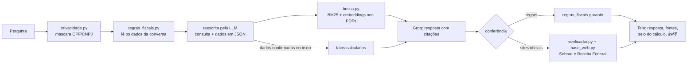

# FiscOn — Chatbot MEI e Receita Federal (FMU · NAF)

[](https://github.com/GabrielAlbSilv/FMU_ChatBot_Mei/actions/workflows/testes.yml)
[](https://github.com/GabrielAlbSilv/FMU_ChatBot_Mei/actions/workflows/avaliacao-semanal.yml)
[](https://github.com/GabrielAlbSilv/FMU_ChatBot_Mei/actions/workflows/atualizar-base.yml)


Assistente virtual que tira dúvidas sobre **MEI** (DAS, DASN-SIMEI, limites, desenquadramento, empregados,
baixa) e **Receita Federal** (IRPF, CPF/CNPJ, Simples Nacional), feito para o **NAF — Núcleo de Apoio Fiscal
da FMU**. Responde com base em documentos oficiais, confere a resposta com os sites do **Sebrae** e da
**Receita Federal**, e tem acessibilidade com **voz** (pergunta falada e leitura da resposta) e **Libras** (VLibras).

> Demo: _coloque aqui o link do serviço no Render_

<p align="center">
  
  
</p>

## Em números

| Número | O que significa |
|---|---|
| **128** testes automatizados | rodam a cada push e antes de publicar PDFs novos (sem internet e sem custo de IA) |
| **18** casos reais de avaliação | erros encontrados pelo NAF + Lei Complementar 238/2026, rodados toda semana com o modelo de verdade |
| **10** regras fiscais calculadas por código | DAS, teto, limite proporcional, excesso de faturamento, IRPF, DASN, DIRF, empregados, perdão de dívidas |
| **2** fontes oficiais aceitas | Sebrae e Receita Federal — lista fechada, validada a cada redirecionamento |
| **0** dados pessoais guardados | CPF, CNPJ, e-mail e telefone são mascarados antes de logs, IA e banco |

A aprovação dos usuários (botões Útil / Não ajudou) e a taxa de respostas corrigidas são acompanhadas no
painel de qualidade (`/painel`).

## Decisões de projeto

| Problema | Decisão |
|---|---|
| Modelos de linguagem erram contas ("34 mil é maior que 35.584") | **As contas são do código, não da IA.** `regras_fiscais.py` calcula limites, DAS, excesso e IRPF a partir de `regras_fiscais.json` (editável pelo NAF). O resultado entra no prompt como *FATOS CALCULADOS* e a resposta é conferida com eles; se contradiz, é refeita. |
| PDFs ficam desatualizados | A resposta é **conferida com páginas oficiais** (só Sebrae e Receita Federal, lista fechada em `verificador.url_permitida`). Uma cópia local dos sites é atualizada a cada 12 h; os PDFs são baixados de novo todo dia pelo GitHub Actions. |
| Lei nova que ainda depende de orçamento (LC 238/2026) | O teto novo fica cadastrado como `"vigente": false`: o bot usa a regra em vigor e **mostra os dois cenários** quando a conclusão muda. |
| A IA ajuda a entender a pergunta, mas pode inventar dados | A reescrita da pergunta devolve um JSON com dados sugeridos; **o código só aceita o que confirma no texto do usuário** (`validar_dados_llm`). |
| Plano gratuito (512 MB, CPU fracionada) | Sem LangChain/Chroma: embeddings ONNX (`fastembed`) + BM25 próprio em numpy, índice gerado no build. |
| LGPD | CPF, CNPJ, e-mail e telefone são **mascarados antes** de logs, cache, banco e da Groq (`privacidade.py`); perguntas guardadas por no máximo 180 dias. |
| Plano gratuito da Groq tem limite por minuto | Ao receber erro 429, a resposta sai por um **modelo reserva** (cada modelo tem a sua própria cota) em vez de mostrar erro. |
| O disco do Render gratuito é apagado a cada reinício | Métricas, votos e avaliações vão para um **PostgreSQL gratuito (Neon)**, gravados em segundo plano: o chat nunca espera o banco. |
| Como saber se uma mudança piorou o bot? | **Avaliação semanal** com o modelo de verdade no GitHub Actions; se algum caso falhar, abre uma *issue* automaticamente. |

## Como funciona



Quando há fatos calculados, o texto só aparece **depois** de conferido com as regras (a pessoa nunca lê uma
conta errada que depois some). Sem fatos, a resposta aparece enquanto é escrita e a conferência com os sites
roda em seguida.

## Rodar localmente

```bash
python -m venv venv && source venv/bin/activate      # Windows: .\venv\Scripts\Activate.ps1
pip install -r requirements.txt
cp .env.example .env                                  # e coloque a GROQ_API_KEY
python preparar_base.py                               # opcional: baixa PDFs novos, gera o índice e coleta os sites
python app.py                                         # http://localhost:5000  e  http://localhost:5000/chat
```

Passo a passo detalhado para Windows/VS Code: [`PassoAPasso.txt`](PassoAPasso.txt).

## Testes

```bash
pip install -r requirements-testes.txt   # leve: os testes simulam a Groq e o fastembed
python testes.py                         # todos (pasta tests/, um arquivo por assunto)
python testes.py RegrasFiscais           # só os que têm "RegrasFiscais" no nome
```

Rodam no GitHub Actions a cada push/PR (`.github/workflows/testes.yml`) e antes de publicar PDFs novos.
O banco é testado com SQLite (mesmo SQL), sem precisar de servidor.

Automação no GitHub (`.github/`):

| Workflow | Quando | O que faz |
|---|---|---|
| `testes.yml` | todo push/PR | testes offline |
| `atualizar-base.yml` | todo dia | baixa PDFs oficiais novos, testa e abre PR |
| `avaliacao-semanal.yml` | segunda, 03:41 | avalia com a Groq de verdade; falhas viram *issue* (secret `GROQ_API_KEY`) |
| `manter-acordado.yml` | a cada 14 min (opcional) | evita que o servidor gratuito durma |
| `dependabot.yml` | toda segunda | PRs com versões novas das bibliotecas e das ações |

Avaliações com o modelo de verdade (precisam da `GROQ_API_KEY` / do `fastembed`):

| Comando | O que mede |
|---|---|
| `python avaliar_casos.py` | Casos do relatório de testes do NAF (valores certos e proibidos). Gera `relatorio_reteste.md` e acrescenta uma linha em `relatorios/historico_avaliacoes.jsonl` para comparar versões. |
| `python avaliar_busca.py [modeloA modeloB]` | Acertos da busca nos PDFs e pico de memória de cada modelo de embeddings — use antes de trocar o `MODELO_EMBEDDINGS` no Render. |
| `python diagnosticar_verificacao.py "pergunta"` | Quais páginas oficiais a conferência escolhe para uma pergunta. |

## Deploy (Render)

`render.yaml` já configura tudo: build com `pip install -r requirements.txt && python preparar_base.py`,
1 worker gunicorn com 4 threads e health check em `/api/status`. No painel do Render, preencha:

- `GROQ_API_KEY` (obrigatória);
- `BASE_WEB_TOKEN` (opcional, para o GitHub Actions pedir coleta dos sites);
- `STATUS_TOKEN`: senha do painel `/painel` e dos detalhes de `/api/status` (cabeçalho `X-Token`);
- `DATABASE_URL` (opcional): PostgreSQL para guardar o histórico — passo a passo em [`docs/BANCO.md`](docs/BANCO.md).

No plano gratuito o servidor dorme sem visitas; o workflow opcional `manter-acordado.yml` evita isso (leia o
custo no próprio arquivo).

## Configuração

Todas as variáveis estão em [`config.py`](config.py) (lista única, com os padrões) e resumidas em
[`.env.example`](.env.example). As mais usadas: `MODELO_LLM`, `MODELO_EMBEDDINGS`, `VERIFICAR_SITES`,
`CONFERENCIA_MODO`, `LIMITE_POR_IP`, `LIMITE_GLOBAL`, `STATUS_TOKEN`.

## Manutenção anual (equipe do NAF)

1. Atualizar `regras_fiscais.json` (salário mínimo, teto do MEI, limites e prazo do IRPF, prazo da DASN).
2. Conferir cada valor na `fonte` indicada e trocar `validado_naf` para `true`. Enquanto houver regra sem
   validação, o servidor avisa nos logs e `/api/status` (com token) lista as pendentes em `regras_nao_validadas`.
3. **LC 238/2026:** quando a lei orçamentária confirmar o novo teto, trocar `"vigente"` para `true` em
   `mei > 2027` (e depois `2028`). O limite novo passa a valer na hora, mesmo antes do salário mínimo do ano.
4. Rodar `python testes.py` e `python avaliar_casos.py` e revisar o `relatorio_reteste.md`.

## Qualidade e feedback

Cada resposta tem botões **Útil / Não ajudou**. Os votos e um resumo de cada resposta (se foi conferida,
atualizada pelos sites ou corrigida pelas regras, tempo, uso do modelo reserva) aparecem:

- no **painel** `/painel` (senha `STATUS_TOKEN`): aprovação, gráfico por dia, respostas marcadas como
  "Não ajudou" (candidatas a novos casos de teste) e o histórico da avaliação semanal;
- nos logs como `[METRICA]` e `[FEEDBACK]` (JSON, já sem dados pessoais);
- no banco PostgreSQL, se `DATABASE_URL` estiver configurada (consultas prontas em `docs/BANCO.md`).

## Estrutura

```
app.py                 servidor Flask (rotas, limites, status, feedback)
config.py              todas as variáveis de ambiente
rag.py                 conversa com o modelo: prompt, streaming, citações, conferência
busca.py               PDFs -> índice (embeddings + BM25) -> trechos
regras_fiscais.py/.json contas e regras por ano-calendário (MEI, DAS, IRPF, LC 238/2026)
verificador.py         conferência com Sebrae e Receita Federal (download seguro, lista de sites)
base_web.py            cópia local dos sites oficiais, atualizada a cada 12 h
pesquisa.py            descobre páginas oficiais para qualquer assunto (sitemaps, busca interna)
privacidade.py         mascara CPF, CNPJ, e-mail e telefone
metricas.py            contadores de qualidade e votos
banco.py               PostgreSQL opcional (fila em segundo plano, retenção de 180 dias)
voz.py                 transcrição da pergunta falada (Groq Whisper)
atualizar_base.py      baixa as versões novas dos PDFs oficiais (fontes_pdfs.json)
preparar_base.py       etapa de build (PDFs, índice, 1ª coleta dos sites)
static/                páginas (início, chat e painel), voz e Libras no navegador
docs/                  guia do banco (BANCO.md) e capturas de tela
tests/                 testes offline;  testes.py roda todos
```

## Limitações conhecidas

- É uma IA: pode errar e não substitui um contador nem os canais oficiais (Portal do Empreendedor, Receita
  Federal). Casos pessoais complexos são encaminhados ao NAF.
- `regras_fiscais.json` precisa de revisão anual pelo NAF; os valores atuais ainda não foram validados.
- O PDF `3-Perguntas&Respostas2_MEI.pdf` vem do Portal do Empreendedor (gov.br/mei), que não está na lista de
  sites de onde o bot baixa sozinho; ele precisa ser trocado manualmente quando sair edição nova.
- Sem `DATABASE_URL`, os contadores de métricas recomeçam quando o servidor reinicia (o disco do plano
  gratuito não é permanente).
